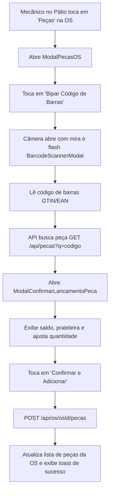

# BRIEFING TÉCNICO: LANÇAMENTO DE PEÇAS NA OS VIA LEITOR DE CÓDIGO DE BARRAS (MOBILE)

## 1. OBJETIVO DA FUNCIONALIDADE

Permitir que o mecânico no box ou o estoquista no pátio utilize a câmera do celular para **escanear o código de barras (GTIN/EAN) ou digitar o código de uma peça e vinculá-la instantaneamente à Ordem de Serviço aberta do veículo**, consultando saldo em tempo real, localização na prateleira, quantidade e confirmando o lançamento sem depender do computador da recepção.

---

## 2. CONTRATOS E ENDPOINTS DO BACKEND

O backend Spring Boot já possui o controlador dedicado em:
`br.com.aftecnologia.gestao.pecas.os.ControladorPecaNaOS` (`/api/os/{osId}/pecas`).

### A. Listar Peças da OS
- **Rota:** `GET /api/os/{osId}/pecas`
- **Permissão:** `os.ver`
- **Retorno:** `List<RespostaItemPecaOS>`
```typescript
interface RespostaItemPecaOS {
  id: string;
  osId: string;
  pecaId: string;
  codigoInterno: string;
  descricao: string;
  quantidade: number;
  custoUnitario?: number;
  precoUnitario: number;
  desconto: number;
  total: number;
  status: 'reservado' | 'aguardando' | 'aplicado' | 'cancelado' | string;
  garantiaAte?: string;
  ordem: number;
  sugerirAguardandoPeca: boolean;
  localizacao?: string; // Prateleira/corredor
  unidade?: string;     // un, l, kg, etc.
}
```

### B. Lançar Peça na OS
- **Rota:** `POST /api/os/{osId}/pecas`
- **Permissão:** `peca.vender`
- **Payload (`PedidoItemPecaOS`):**
```json
{
  "pecaId": "uuid-da-peca",
  "quantidade": 1.0,
  "precoUnitario": null,
  "desconto": null
}
```
> **Nota de Negócio:** Se `precoUnitario` for nulo, a API usa o preço de tabela da peça. Se a peça não tiver saldo suficiente, a API não bloqueia: ela grava o item com status `aguardando` e retorna `sugerirAguardandoPeca: true`.

### C. Alterar Quantidade de Peça Lançada
- **Rota:** `PATCH /api/os/{osId}/pecas/{itemId}`
- **Permissão:** `peca.vender`
- **Payload (`PedidoQuantidadeItemPecaOS`):**
```json
{
  "quantidade": 2.0
}
```

### D. Aplicar Peça (Baixa Física / Montada no Carro)
- **Rota:** `POST /api/os/{osId}/pecas/{itemId}/aplicar?motivo={motivoOpcional}`
- **Permissão:** `peca.vender`
- **Efeito:** Marca a peça como aplicada no carro e efetiva a saída do estoque.

### E. Cancelar / Remover Peça da OS
- **Rota:** `DELETE /api/os/{osId}/pecas/{itemId}`
- **Permissão:** `peca.vender`
- **Efeito:** Desvincula a peça da OS e devolve a reserva ao estoque da oficina.

### F. Totalizador de Peças da OS
- **Rota:** `GET /api/os/{osId}/pecas/total`
- **Retorno:** `{ "total": 150.00 }`

---

## 3. ARQUITETURA DE ARQUIVOS A CRIAR E MODIFICAR NO MOBILE

### A. Camada de Tipagem (`src/types/index.ts`)
Adicionar:
- `RespostaItemPecaOS`
- `PedidoItemPecaOS`
- `PedidoQuantidadeItemPecaOS`

### B. Camada de Comunicação HTTP (`src/api/pecasOSApi.ts`)
Criar o módulo com as funções:
1. `listarPecas(osId: string): Promise<RespostaItemPecaOS[]>`
2. `obterTotalPecas(osId: string): Promise<number>`
3. `lancarPeca(osId: string, pedido: PedidoItemPecaOS): Promise<RespostaItemPecaOS>`
4. `alterarQuantidade(osId: string, itemId: string, quantidade: number): Promise<RespostaItemPecaOS>`
5. `aplicarPeca(osId: string, itemId: string, motivo?: string): Promise<RespostaItemPecaOS>`
6. `removerPeca(osId: string, itemId: string): Promise<void>`

### C. Componentes de Interface (UI)
1. **`src/components/ModalPecasOS.tsx`:**
   - Modal ou tela de gerenciamento de peças daquela OS específica.
   - Cabeçalho: Placa Mercosul estilizada (`PlacaVeiculo`), número da OS, cliente e veículo.
   - Botões superiores:
     - **"Bipar Código de Barras"** (abre a câmera via `BarcodeScannerModal`).
     - **"Buscar no Catálogo"** (busca por texto).
   - Lista dos itens já lançados:
     - Descrição, Código interno, Quantidade, Preço unitário e Valor total.
     - Destaque para localização no estoque (ex: `Prateleira B3`).
     - Badge de status (`Reservado` em azul, `Aplicado` em verde, `Sem Saldo / Aguardando` em amarelo).
     - Botões de ação rápida por item:
       - **Aplicar:** marca como montada no veículo.
       - **+ / - :** ajusta a quantidade.
       - **Lixeira:** remove da OS com confirmação.
   - Rodapé: Total em R$ de peças na OS e botão de fechar.

2. **`src/components/ModalConfirmarLancamentoPeca.tsx`:**
   - Abre automaticamente assim que a câmera lê o código de barras da peça (ou ao tocar na peça pela busca).
   - Exibe:
     - Descrição da peça, Código interno, Marca/Fabricante.
     - **Saldo disponível** (badge verde se > 0, vermelho se <= 0).
     - **Localização na prateleira** em destaque visual.
     - Preço de tabela sugerido.
     - Seletor de quantidade com botões `-` e `+` e campo numérico.
     - Aviso visual caso a quantidade seja maior que o saldo em estoque.
     - Botões **"Cancelar"** e **"Confirmar e Adicionar à OS"**.

### D. Integração nos Fluxos Existentes
1. **Na Tela do Pátio (`src/screens/PatioScreen.tsx`):**
   - No card da OS, adicionar um botão de ação com ícone de engrenagem/peça: **"Peças"** (ou atalho direto).
   - Ao tocar, abre o `ModalPecasOS` carregando as peças daquela OS.
2. **Na Tela de Estoque (`src/screens/EstoqueScreen.tsx`):**
   - Ao consultar uma peça, incluir botão **"Lançar em uma OS"**, exibindo modal rápido para escolher o veículo/OS aberta no pátio.

---

## 4. FLUXO DO USUÁRIO PASSO A PASSO



---

## 5. COMANDOS DE VALIDAÇÃO TÉCNICA

Ao concluir a implementação, validar obrigatoriamente:

```bash
# 1. Typecheck TypeScript estrito
npx tsc --noEmit

# 2. Diagnóstico de dependências Expo
npx expo-doctor

# 3. Teste de empacotamento dos bundles Metro iOS e Android
npx expo export --no-bytecode
```
