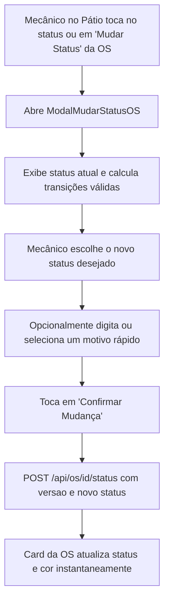

# BRIEFING TÉCNICO: MUDANÇA DE STATUS DA ORDEM DE SERVIÇO NO PÁTIO (MOBILE)

## 1. OBJETIVO DA FUNCIONALIDADE

Permitir que o mecânico, técnico ou encarregado de pátio **altere o status da Ordem de Serviço diretamente pelo aplicativo celular** (ex: avançar de *Recebido ➔ Em Diagnóstico*, *Aprovado ➔ Em Execução*, *Em Execução ➔ Pronto* ou pausar para *Aguardando Peça*), sem necessidade de se deslocar até um computador da recepção.

A funcionalidade deve:
1. Respeitar as transições válidas da máquina de estados oficial do backend (`StatusOS.java`).
2. Implementar o bloqueio otimista via campo `versao`, evitando sobrescritas acidentais caso dois usuários mexam na mesma OS simultaneamente.
3. Permitir registrar um motivo/observação opcional para a transição (especialmente útil ao pausar para *Aguardando Peça* ou ao retornar de *Pronto* para *Em Execução*).
4. Atualizar imediatamente o card da OS no pátio com o novo status e cor sem recarregar a tela inteira.

---

## 2. CONTRATOS E ENDPOINTS DO BACKEND

O backend Spring Boot disponibiliza o controlador em:
`br.com.aftecnologia.gestao.oficina.os.ControladorOrdemServico` (`/api/os`).

### A. Endpoint de Transição de Status
- **Rota:** `POST /api/os/{id}/status`
- **Permissão:** `kanban.mover` *(e `os.cancelar` caso o destino seja `cancelada`)*
- **Payload (`PedidoTransicao`):**
```json
{
  "status": "em-execucao",
  "versao": 3,
  "motivo": "Mecânico iniciou reparo no elevador 1",
  "boxId": null
}
```
- **Retorno:** `ContratosOS.RespostaOS` com os dados atualizados da OS e novo número de `versao`.

---

## 3. MÁQUINA DE ESTADOS E TRANSIÇÕES VÁLIDAS

Conforme implementado no backend (`StatusOS.java`), as transições permitidas a partir de cada status atual são:

| Status Atual (`chave`) | Rótulo Amigável | Transições Permitidas no App |
|---|---|---|
| `agendado` | Agendado | `recebido`, `cancelada` |
| `recebido` | Veículo Recebido | `em-diagnostico`, `aguardando-aprovacao`, `aprovado`, `aguardando-peca`, `cancelada` |
| `em-diagnostico` | Em Diagnóstico | `aguardando-aprovacao`, `aprovado`, `aguardando-peca`, `cancelada` |
| `aguardando-aprovacao` | Aguardando Aprovação | `aprovado`, `reprovado`, `aguardando-peca`, `cancelada` |
| `aprovado` | Orçamento Aprovado | `em-execucao`, `aguardando-peca`, `cancelada` |
| `aguardando-peca` | Aguardando Peça | `em-execucao`, `aprovado`, `cancelada` |
| `em-execucao` | Em Execução | `pronto`, `aguardando-peca`, `aguardando-aprovacao`, `cancelada` |
| `pronto` | Pronto para Entrega | `entregue`, `em-execucao` |
| `reprovado` | Orçamento Reprovado | `aprovado`, `aguardando-peca` |
| `entregue` | Entregue | *(Estado final / sem transições)* |
| `cancelada` | Cancelada | *(Estado final / sem transições)* |

> **Nota:** As chaves de status no backend usam hífen (`em-diagnostico`, `em-execucao`, `aguardando-peca`, `aguardando-aprovacao`). O app deve enviar a chave exata esperada pelo enum `StatusOS`.

---

## 4. ARQUITETURA DE ARQUIVOS A CRIAR E MODIFICAR NO MOBILE

### A. Tipos e Contratos (`src/types/index.ts`)
Adicionar:
```typescript
export interface PedidoTransicaoStatusOS {
  status: string;
  versao: number;
  motivo?: string;
  boxId?: string | null;
}

export interface StatusTransicaoInfo {
  chave: string;
  rotulo: string;
  descricao: string;
  icone: string;
  cor: string;
  destaque?: boolean;
}
```

### B. Módulo de API (`src/api/osApi.ts`)
Adicionar método à `osApi`:
```typescript
async mudarStatus(osId: string, pedido: PedidoTransicaoStatusOS): Promise<any> {
  const response = await clienteHttp.post(`/api/os/${osId}/status`, pedido);
  return response.data;
}
```

### C. Mapeamento de Transições (`src/constants/transicoesOS.ts`)
Criar arquivo centralizando a tabela de transições e metadados de cada status:
- Lista de próximos estados recomendados para cada status atual.
- Ícones (Ionicons), cores semânticas e textos descritivos para orientar o mecânico.

### D. Componente Visual (`src/components/ModalMudarStatusOS.tsx`)
Criar modal interativo contendo:
1. **Cabeçalho:**
   - Placa Mercosul estilizada (`PlacaVeiculo`).
   - Número da OS e Descrição do Veículo.
   - Status atual exibido com `StatusBadge`.
2. **Seleção do Próximo Status:**
   - Lista das transições válidas disponíveis a partir do status atual.
   - Destaque visual no próximo passo natural do fluxo (ex: se `recebido`, destacar `Iniciar Diagnóstico`; se `aprovado`, destacar `Iniciar Execução`; se `em-execucao`, destacar `Marcar como Pronto`).
   - Cards com botões de toque largo para uso fácil com luvas ou dedos de oficina.
3. **Campo Opcional:**
   - `TextInput` multi-linha para "Motivo / Observação da Mudança" (com botão de tags rápidas, ex: *"Peças chegaram"*, *"Testado na rua"*, *"Falta autorização"*).
4. **Botão de Confirmação:**
   - Botão **"Confirmar Mudança de Status"** com feedback de carregamento (`ActivityIndicator`).
   - Tratamento de erro 409 (conflito de versão caso outro usuário já tenha alterado a OS).

### E. Integração na Tela do Pátio (`src/screens/PatioScreen.tsx`)
1. No card da OS, permitir tocar no badge de status ou em um botão **"Mudar Status"** (ícone `swap-horizontal` ou seta de fluxo).
2. Opcionalmente, exibir um botão de avanço rápido no rodapé do card para o próximo status recomendado (ex: `▶ Iniciar Serviço` se estiver aprovado).
3. Ao concluir a mudança de status com sucesso:
   - Atualizar a OS localmente no estado `ordens` com o novo status e nova versão.
   - Exibir toast/alerta de sucesso.

---

## 5. FLUXO DO USUÁRIO



---

## 6. COMANDOS DE VALIDAÇÃO TÉCNICA

Ao concluir a implementação, validar obrigatoriamente:

```bash
# 1. Typecheck TypeScript estrito
npx tsc --noEmit

# 2. Diagnóstico de dependências Expo
npx expo-doctor

# 3. Teste de empacotamento dos bundles Metro iOS e Android
npx expo export --no-bytecode
```
