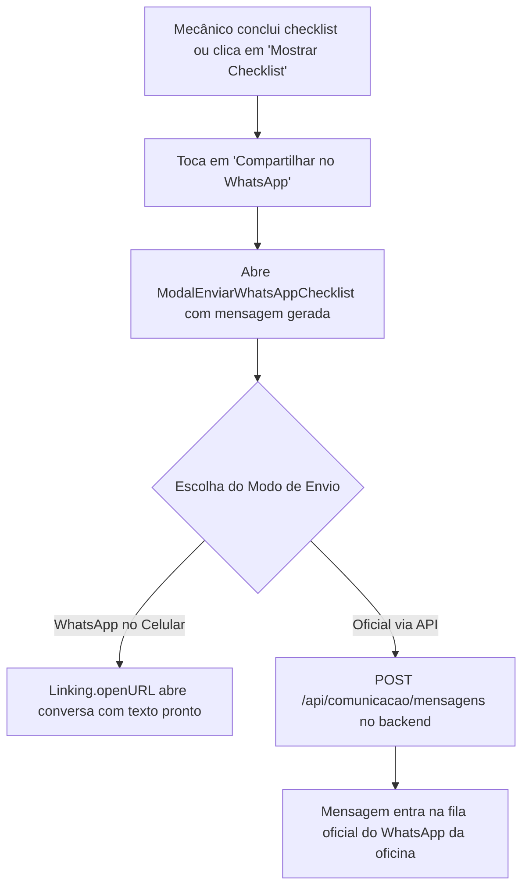

# BRIEFING TÉCNICO: NOTIFICAÇÃO E LAUDO DE CHECKLIST VIA WHATSAPP (MOBILE)

## 1. OBJETIVO DA FUNCIONALIDADE

Permitir que, logo após concluir a vistoria (ou ao consultar um checklist já preenchido), o vistoriador/mecânico possa **enviar a notificação e o laudo de vistoria do veículo diretamente para o WhatsApp do cliente**.

A funcionalidade deve oferecer suporte a **duas modalidades**:
1. **Envio Oficial via API do Backend (`POST /api/comunicacao/mensagens`):** Dispara a mensagem através do provedor oficial de WhatsApp Business configurado na oficina (Z-API / Meta Cloud API), ficando arquivada no histórico de comunicação da OS.
2. **Abertura Direta no WhatsApp do Celular (`Linking.openURL`):** Abre o aplicativo do WhatsApp instalado no smartphone do mecânico com a mensagem pré-formatada e o número do cliente selecionado (`whatsapp://send?phone=...&text=...` com fallback para `https://wa.me/...`).

---

## 2. CONTRATOS E ENDPOINTS DO BACKEND

O backend Spring Boot disponibiliza o controlador em:
`br.com.aftecnologia.gestao.comunicacao.conversa.ControladorComunicacao` (`/api/comunicacao`).

### A. Obter Contatos e Conversa da OS
- **Rota:** `GET /api/comunicacao/os/{osId}/conversa`
- **Permissão:** `@planos.exige('comunicacao.central') and hasAuthority('comunicacao.ver')`
- **Retorno (`RespostaConversaDaOS`):**
```typescript
interface ContatoDaOS {
  id: string;
  nome: string;
  cargo?: string;
  telefoneExibicao: string;
  principal: boolean;
}

interface RespostaConversaDaOS {
  osId: string;
  osNumero: number;
  clienteId: string;
  clienteNome: string;
  contatos: ContatoDaOS[];
  contatoId?: string;
  escolhaLembrada: boolean;
  conversa?: {
    id: string;
    canal: string;
    identificador: string;
    status: string;
    janelaAberta: boolean;
    segundosRestantes: number;
  };
}
```

### B. Enviar Mensagem Manualmente via API
- **Rota:** `POST /api/comunicacao/mensagens`
- **Permissão:** `@planos.exige('comunicacao.central') and hasAuthority('comunicacao.enviar')`
- **Payload (`PedidoManual`):**
```json
{
  "clienteId": "uuid-do-cliente",
  "contatoId": "uuid-do-contato-opcional",
  "osId": "uuid-da-os",
  "canal": "whatsapp",
  "corpo": "Texto da mensagem formatada...",
  "templateId": null
}
```

---

## 3. FORMATAÇÃO PADRÃO DA MENSAGEM DO LAUDO

A mensagem gerada dinamicamente deve ser elegante e bem legível no WhatsApp:

```text
Olá, *{{clienteNome}}*! 👋
Recebemos o seu veículo *{{veiculoDescricao}}* (Placa *{{placa}}*) na *{{nomeOficina}}*.

📋 *Ordem de Serviço:* #{{osNumero}}
🗓️ *Vistoria:* {{tipoVistoria}} — {{dataHora}}
🚗 *Odômetro:* {{km}} km
⛽ *Nível de Combustível:* {{combustivel}}%
🧰 *Pertences no Veículo:* {{pertences}}

{{secaoAvarias}}

{{secaoItensSeguranca}}

✍️ _Vistoria conferida e assinada digitalmente na recepção do pátio._
Assim que tivermos o diagnóstico técnico completo, entraremos em contato por aqui!
```

---

## 4. ARQUITETURA DE ARQUIVOS A CRIAR E MODIFICAR NO MOBILE

### A. Camada de Tipagem (`src/types/index.ts`)
Adicionar:
- `ContatoDaOS`
- `RespostaConversaDaOS`
- `PedidoEnvioMensagemOS`

### B. Camada de API (`src/api/comunicacaoApi.ts`)
Criar o módulo com:
1. `obterConversaDaOS(osId: string): Promise<RespostaConversaDaOS>`
2. `enviarMensagemOficial(pedido: PedidoEnvioMensagemOS): Promise<any>`

### C. Utilitário de Deep Link (`src/utils/whatsappHelper.ts`)
Criar utilitário para:
1. Formatar texto do laudo com base na `RespostaOSResumo` e no `RespostaChecklist`.
2. Sanitizar o número de telefone (remover caracteres especiais, garantir DDI `55`).
3. Abrir o WhatsApp do aparelho via `Linking.openURL` (`whatsapp://send?phone=...&text=...`), com fallback automático para navegador web (`https://wa.me/...`).

### D. Componente Visual (`src/components/ModalEnviarWhatsAppChecklist.tsx`)
- Modal de envio contendo:
  - Cabeçalho: Placa do veículo, número da OS e nome do cliente.
  - Seletor de contato/telefone do cliente (caso haja mais de um número cadastrado).
  - Campo de texto multi-linha com a mensagem pré-preenchida, permitindo ajustes ou observações antes do envio.
  - Resumo visual de entrega (se a oficina possui integração oficial de API ativa).
  - Botão principal destacado: **"Abrir no WhatsApp do Celular"** (ícone WhatsApp `#25D366`).
  - Botão secundário: **"Disparar pelo Canal Oficial da Oficina"** (envio via API backend).

### E. Pontos de Integração na Interface
1. **Em `src/components/ChecklistDetalhesModal.tsx`:**
   - Adicionar botão de ação no rodapé ou no cabeçalho: **"Compartilhar no WhatsApp"** (cor `#25D366` com ícone `logo-whatsapp`).
   - Ao tocar, abre o `ModalEnviarWhatsAppChecklist`.
2. **Em `src/screens/ChecklistScreen.tsx` (Passo 5 - Conclusão do Envio):**
   - Ao exibir a tela de sucesso do checklist recém-gravado, adicionar botão de atalho **"Enviar Laudo ao Cliente via WhatsApp"** antes de voltar ao pátio.
3. **Em `src/screens/PatioScreen.tsx`:**
   - No menu ou card da OS que já possui checklist preenchido, disponibilizar atalho de envio rápido por WhatsApp.

---

## 5. FLUXO DO USUÁRIO



---

## 6. COMANDOS DE VALIDAÇÃO TÉCNICA

Ao concluir a implementação, validar obrigatoriamente:

```bash
# 1. Typecheck TypeScript estrito
npx tsc --noEmit

# 2. Diagnóstico de dependências Expo
npx expo-doctor

# 3. Teste de empacotamento dos bundles Metro iOS e Android
npx expo export --no-bytecode
```
